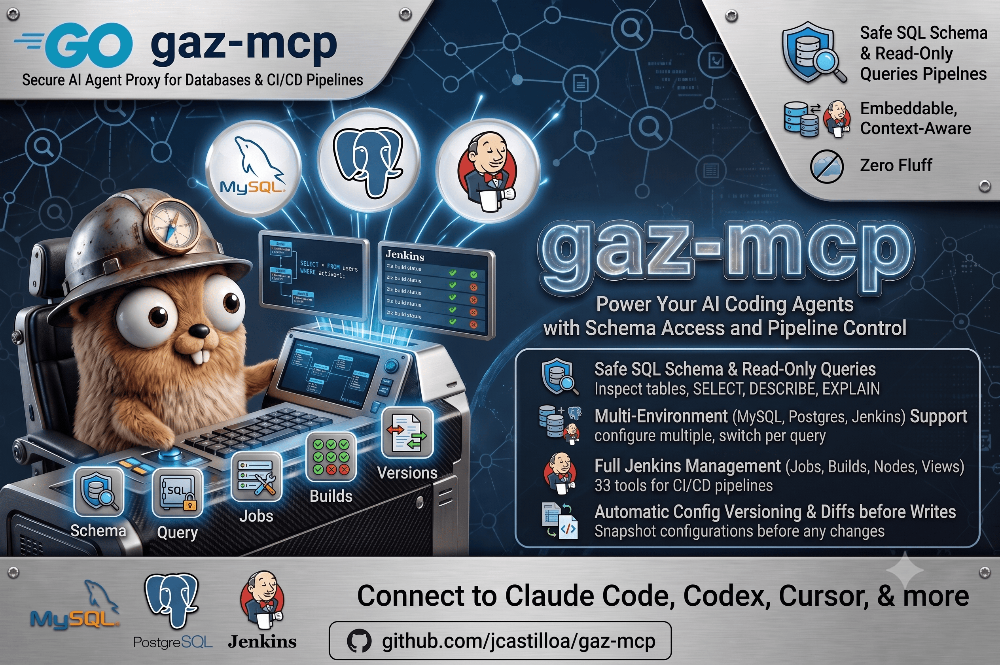

# gaz-mcp

`gaz-mcp` is an MCP server for read-only MySQL/PostgreSQL access, Jenkins administration with configuration history, OpenRouter image generation, and diagnosis of running Go processes through `pprof` and `expvar`. It also ships the independent [`diagnostics`](diagnostics/) Go module for adding those endpoints to target services.

It uses stdio transport: one binary, no daemon, and no listener opened by the MCP itself. SQL and Jenkins targets are configured once; a Go diagnostic target is supplied directly with each tool call.

## Capabilities

| Capability | Purpose | Configuration | Complete guide |
|---|---|---|---|
| SQL | Inspect MySQL and PostgreSQL data without writes | `environments` | [SQL: MySQL and PostgreSQL](docs/sql.md) |
| Jenkins | Inspect and administer CI/CD, including configuration history | `jenkins`, `snapshot` | [Jenkins](docs/jenkins.md) |
| Image generation | Generate and compare images through a closed OpenRouter model allowlist | `image_generation` | [Image generation](docs/image-generation.md) |
| Go diagnostics | Capture profiles and inspect goroutines, runtime/process/host/cgroup metrics, and optional SQL pools | Per-call `target` URL | [Go process diagnostics](docs/go-process-diagnostics.md) |

### Shared properties

- **MCP stdio server** — one binary, no daemon, no network ports.
- **Multi-environment SQL and Jenkins** — select the configured environment per call.
- **Read-only SQL enforcement** — application checks plus database read-only sessions.
- **Dynamic database selection** — the database belongs to each SQL request, not to static configuration.
- **Jenkins toolset** — 33 tools for jobs, builds, nodes, views, queue, plugins, credentials, script console, and snapshots.
- **Configuration history** — Jenkins snapshots are held in SQLite for the operations that support capture and rollback.
- **SHA-256 deduplication** — identical consecutive configuration snapshots are not stored twice.
- **Controlled image generation** — choose a configured OpenRouter image model per request, with prompt, seed references, dimensions, quality, format, seed, and provider routing controls.
- **Go process diagnosis** — pprof profiles, grouped goroutine stacks, raw runtime/process/host/cgroup metrics, and a separate list of evidence-backed heuristic suspicions.
- **Structured JSON output** — designed for programmatic consumption.
- **YAML configuration** — Viper-based configuration, with deployment-time secret rendering.
- **Hexagonal architecture** — domain, application, and platform layers remain separate.

## Requirements

- The Go version declared in [`go.mod`](go.mod) (currently Go **1.26.0**) to build from source, or a prebuilt binary.
- A MySQL/PostgreSQL server and/or Jenkins instance reachable from the host running the MCP.

## Installation

### Build from source

```bash
go build -o gaz-mcp ./cmd/server/
```

### Prebuilt binary

Linux and macOS:

```bash
# Latest release
curl -fsSL https://raw.githubusercontent.com/jcastilloa/gaz-mcp/master/scripts/install.sh | sh

# Specific version
curl -fsSL https://raw.githubusercontent.com/jcastilloa/gaz-mcp/master/scripts/install.sh | VERSION=vX.Y.Z sh
```

| Variable | Default |
|---|---|
| `REPO` | `jcastilloa/gaz-mcp` |
| `SERVICE_NAME` | `gaz-mcp` |
| `INSTALL_DIR` | `~/.local/bin` |
| `VERSION` | Latest release tag |

### Agent skills

Product-facing agent skills are distributed under [`skills/`](skills/), separately from the `.codex/skills` used to develop this repository:

| Skill | Capability |
|---|---|
| [`gaz-mcp-db`](skills/gaz-mcp-db/SKILL.md) | Read-only MySQL and PostgreSQL inspection |
| [`gaz-mcp-jenkins`](skills/gaz-mcp-jenkins/SKILL.md) | Jenkins operations and configuration history |
| [`gaz-mcp-diagnostics`](skills/gaz-mcp-diagnostics/SKILL.md) | Go service instrumentation, pprof, expvar, metrics, and diagnostic suspicions |

Install the complete directory for every enabled capability. For example, from a gaz-mcp checkout, copy them into a separate project that consumes the MCP:

```bash
GAZ_MCP_DIR=/path/to/gaz-mcp
CONSUMER_PROJECT=/path/to/project-using-gaz-mcp
mkdir -p "$CONSUMER_PROJECT/.codex/skills"
cp -R "$GAZ_MCP_DIR/skills/gaz-mcp-db" "$CONSUMER_PROJECT/.codex/skills/"
cp -R "$GAZ_MCP_DIR/skills/gaz-mcp-jenkins" "$CONSUMER_PROJECT/.codex/skills/"
cp -R "$GAZ_MCP_DIR/skills/gaz-mcp-diagnostics" "$CONSUMER_PROJECT/.codex/skills/"
```

See the [skills catalog](skills/README.md) for project/global paths in Claude Code, Codex, OpenCode, and Cursor, plus the boundary between product and contributor skills.

## Configuration

Create `config.yaml` in the working directory or at `~/.config/gaz-mcp/config.yaml`.

```yaml
service:
  transport: stdio
  version: 0.4.0

# SQL environments (MySQL + PostgreSQL)
environments:
  dev1:
    engine: mysql
    host: 127.0.0.1
    port: 3306
    user: readonly_user
    password: your-password

  analytics:
    engine: postgres
    host: 127.0.0.1
    port: 5432
    user: postgres
    password: your-password

# Jenkins environments
jenkins:
  production:
    url: https://jenkins.example.com
    user: admin
    api_key: "${JENKINS_PROD_API_KEY}" # Jenkins API token or password
    timeout: 30s
    insecure: false
  staging:
    url: https://jenkins-staging.example.com
    user: admin
    api_key: "${JENKINS_STAGING_API_KEY}"
    timeout: 30s
    insecure: true # allow self-signed TLS

# Jenkins configuration history (SQLite, pure Go)
snapshot:
  enabled: true
  db_path: ~/.config/gaz-mcp/jenkins_history.db
  max_versions: 50 # positive retention limit per object
  auto_prune: true

# OpenRouter image generation. models is a closed allowlist: image_generate
# rejects every model not declared here.
image_generation:
  api_key: "${OPENROUTER_API_KEY}"
  base_url: https://openrouter.ai/api/v1
  timeout: 2m
  models:
    - openai/gpt-image-1
    - google/gemini-2.5-flash-image
```

`engine` defaults to `mysql` when it is omitted. The SQL `database` is selected by the tool call, not here. For images, `image_model_list` returns the configured allowlist and `image_generate` selects one of its entries per call. The Go diagnostic `target` is likewise deliberately not configured here: the caller supplies the authorised process URL for each request.

> **Configuration note:** `image_generation.api_key` expands `${NAME}` from the process environment. Keep all other secret placeholders under deployment-time configuration control. `max_versions` is currently normalised to the default of 50 when configured as zero or another non-positive value, so use a positive value in YAML.

> **Security:** use `${OPENROUTER_API_KEY}` (or another deployment-time secret mechanism) for `image_generation.api_key`; it is masked in JSON output. The image tools are registered only when `image_generation.models` is non-empty, and an API key is then required. Jenkins `api_key` accepts a Jenkins API token (recommended, created in *User → Configure → API Token*) or a password. Keep resolved secrets out of version control and use restricted deployment-time configuration.

See [`config.sample.yaml`](config.sample.yaml) for the complete sample, including the OpenAI provider settings used by the application.

## Quick start

### 1. Configure

```bash
cp config.sample.yaml config.yaml
# Edit the environments, jenkins, snapshot, and image_generation sections, then render secret placeholders.
```

### 2. Run

```bash
go run ./cmd/server/ --transport stdio
# Or with the built binary:
./gaz-mcp --transport stdio
```

### 3. Register in an MCP client

#### Claude Desktop, Cursor, and JSON-based clients

```json
{
  "mcpServers": {
    "gaz-mcp": {
      "command": "/absolute/path/to/gaz-mcp",
      "args": ["--transport", "stdio"]
    }
  }
}
```

#### Codex (TOML)

```toml
[mcp_servers.gaz-mcp]
command = "/absolute/path/to/gaz-mcp"
args = ["--transport", "stdio"]
startup_timeout_sec = 20.0
```

#### Codex CLI

```bash
codex mcp add gaz-mcp -- /absolute/path/to/gaz-mcp --transport stdio
```

#### OpenCode

```bash
opencode mcp add
```

Follow the prompts: project or global, name `gaz-mcp`, type `local`, then command `/absolute/path/to/gaz-mcp --transport stdio`.

Always use an absolute binary path and stdio transport.

## Documentation map

The root document contains installation, configuration, client setup, architecture, and development. The complete operational references live in the focused guides below; none of the tool reference is intentionally duplicated here.

| Guide | Includes |
|---|---|
| [SQL: MySQL and PostgreSQL](docs/sql.md) | `sql_query` contract, MySQL/PostgreSQL discovery patterns, both read-only protections, and pool limits |
| [Jenkins](docs/jenkins.md) | All 33 tools, exact parameters, snapshots and restore coverage, large-output distillation, workflows, and security notes |
| [Go process diagnostics](docs/go-process-diagnostics.md) | Service-side `pprof`/`expvar` snippet, optional `database/sql` metrics, all nine tools, findings, and profiling workflows |

The service-side module is released independently using module-compatible tags
such as `diagnostics/v0.1.0`; MCP server release tags (`v0.4.x`) are not module
versions for `github.com/jcastilloa/gaz-mcp/diagnostics`.

To move the service endpoints from `/debug/...` to a custom prefix, use
`diagnostics.WithBasePath("/internal/diagnostics")`; then pass
`http://service:6060/internal/diagnostics` as the diagnostic tool `target`.

## Architecture

```text
gaz-mcp/
├── cmd/server/              # Entry point
├── diagnostics/             # Independent service-side instrumentation Go module
├── skills/                  # Product-facing agent skills distributed to gaz-mcp users
├── mcp/
│   ├── application/
│   │   ├── diagnostics/     # Go process diagnosis use cases
│   │   ├── image/           # Image-generation use cases
│   │   ├── jenkins/         # Jenkins use cases + NoopSnapshotRepository
│   │   └── sql/             # SQL use case (read-only enforcement)
│   └── domain/
│       ├── diagnostics/     # Diagnostic target and profile-store ports
│       ├── image/           # Image-generation repository port
│       ├── jenkins/         # Repository + SnapshotRepository ports
│       └── sql/             # Repository port
├── platform/
│   ├── config/              # Viper config reader
│   ├── di/                  # Dependency injection container
│   └── mcp/
│       ├── commands/        # Cobra runner + tool wiring
│       ├── diagnostics/     # HTTP pprof/expvar adapter + profile store
│       ├── image/           # OpenRouter image API adapter
│       ├── jenkins/         # gojenkins infrastructure adapter
│       ├── server/          # MCP server wrapper
│       ├── snapshot/        # SQLite snapshot repository
│       ├── sql/             # MySQL + PostgreSQL adapters
│       └── tools/           # MCP tool definitions
└── shared/
    ├── ai/domain/           # AI provider contracts
    └── config/domain/       # Configuration contracts
```

**Dependency rule:** `platform → shared + mcp/application + mcp/domain`. Never reverse that direction.

## Development

```bash
go build ./...                                    # Build all packages
go vet ./...                                      # Static analysis
go test ./...                                     # All tests
go test ./mcp/application/jenkins/... -v          # Jenkins service unit tests
go test ./platform/mcp/snapshot/... -v            # SQLite snapshot integration tests
go test ./mcp/application/diagnostics/... -v      # Diagnostic service tests
go test ./platform/mcp/diagnostics/... -v         # HTTP adapter and profile-store tests
(cd diagnostics && go test ./...)                 # Service-side instrumentation module
```

## License

Copyright (c) 2026 jcastilloa.

Permission is hereby granted, free of charge, to any person obtaining a copy
of this software and associated documentation files (the "Software"), to deal
in the Software without restriction, including without limitation the rights
to use, copy, modify, merge, publish, distribute, sublicense, and/or sell
copies of the Software, and to permit persons to whom the Software is
furnished to do so, subject to the following conditions:

The above copyright notice and this permission notice shall be included in all
copies or substantial portions of the Software.

THE SOFTWARE IS PROVIDED "AS IS", WITHOUT WARRANTY OF ANY KIND, EXPRESS OR
IMPLIED, INCLUDING BUT NOT LIMITED TO THE WARRANTIES OF MERCHANTABILITY,
FITNESS FOR A PARTICULAR PURPOSE AND NONINFRINGEMENT. IN NO EVENT SHALL THE
AUTHORS OR COPYRIGHT HOLDERS BE LIABLE FOR ANY CLAIM, DAMAGES OR OTHER
LIABILITY, WHETHER IN AN ACTION OF CONTRACT, TORT OR OTHERWISE, ARISING FROM,
OUT OF OR IN CONNECTION WITH THE SOFTWARE OR THE USE OR OTHER DEALINGS IN THE
SOFTWARE.
